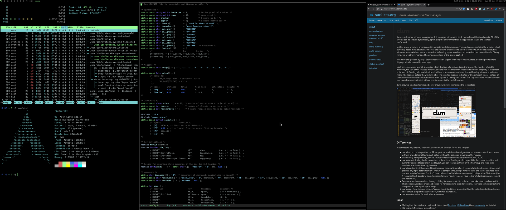

# My dwm hacks

My patches and hacks to [dwm](https://dwm.suckless.org/).

Patching guide: <https://dwm.suckless.org/customisation/patches_in_git/>.

## Branches

`main` is my default branch, containing my hacks and patches.

`master` tracks upstream [dwm](http://git.suckless.org/dwm/).

## Updates

Merge upstream updates to [dwm](https://dwm.suckless.org/):

    git checkout master
    git remote add upstream git://git.suckless.org/dwm
    git fetch upstream
    git merge upstream/master

Merge updates into feature branch:

    git checkout master
    git pull -v --all
    git checkout <feature-branch>
    git rebase --preserve-merges master
    ... fix merge conflicts ...
    git rebase --continue
    git push origin

Pull-request feature branch against `main`.

## Install

    git checkout main
    make
    sudo make install

## Test

    sudo pacman -S xorg-server-xephyr
    startx -- /usr/bin/Xephyr -screen 2560x1440 :1

## Patches

### modkey

Change modkey to Super.

    /* key definitions */
    #define MODKEY Mod4Mask

### resizehints

With `resizehints` on, some text-based windows, such as emacs and
terminals, will not fill their tile. This is particularly a problem in
monocle, where the screen will not be filled.

In `config.h`:

    static const int resizehints = 0;    /* 1 means respect size hints in tiled resizals */

### noborder

-   <https://dwm.suckless.org/patches/noborder/>

Remove border on single visible window, fixed version.

    wget https://dwm.suckless.org/patches/noborder/dwm-noborderfloatingfix-6.2.diff
    git apply dwm-noborderfloatingfix-6.2.diff

### three column

-   <https://dwm.suckless.org/patches/three-column/>

Three-columns with centered master, for widescreen monitor.

    wget https://dwm.suckless.org/patches/three-column/tcl.c

Replace `layout()` in `config.h`:

    #include "tcl.c"
    static Layout layout[] = {
            /* symbol               function */
            { "[T]", tile }, /* first entry is default */
            { "[F]", floating },
            { "[M]", monocle },
            { "[C]", tcl },
    };

Add keybinding in `keys[]`:

    { MODKEY,                       XK_c,      setlayout,      {.v = &layouts[3]} },

### classtitle

Modify first statement in `updatetitle()` to use short window CLASS
rather than full TITLE in the statusbar:

    -	if (!gettextprop(c->win, netatom[NetWMName], c->name, sizeof c->name))
    -		gettextprop(c->win, XA_WM_NAME, c->name, sizeof c->name);
    +       gettextprop(c->win, XA_WM_CLASS, c->name, sizeof c->name);

### appearance

Appearance mods: border, font and colour.

    static const unsigned int borderpx  = 3;        /* border pixel of windows */
    static const char *fonts[]          = { "xos4 Terminus:size=12" };
    static const char dmenufont[]       = "xos4 Terminus:size=12";
    static const char col_black[]       = "#000000";
    static const char col_green[]       = "#98fb98"; /* PaleGreen */
    static const char *colors[][3]      = {
            /*               fg         bg         border   */
            [SchemeNorm] = { col_gray3, col_black, col_black },
            [SchemeSel]  = { col_green, col_black, col_gray2 },

### colemak

Extra movement keys for Colemak home row.

    { MODKEY,                       XK_n,      focusstack,     {.i = +1 } },
    { MODKEY,                       XK_e,      focusstack,     {.i = -1 } },

### movestack

-   <https://dwm.suckless.org/patches/movestack/>

Move clients around in the stack.

This patch doesn't apply, but extract the file `movestack.c` from the [diff](https://dwm.suckless.org/patches/movestack/dwm-movestack-6.1.diff).

Add include in `config.h`:

    #include "movestack.c"

Add keybindings in `config.h`:

    { MODKEY|ShiftMask,             XK_j,      movestack,      {.i = +1 } },
    { MODKEY|ShiftMask,             XK_k,      movestack,      {.i = -1 } },
    { MODKEY|ShiftMask,             XK_n,      movestack,      {.i = +1 } },
    { MODKEY|ShiftMask,             XK_e,      movestack,      {.i = -1 } },

### pertag

-   <https://dwm.suckless.org/patches/pertag/>

Keep layout per tag, instead of changing globally.

    wget https://dwm.suckless.org/patches/pertag/dwm-pertag-20200914-61bb8b2.diff
    git apply dwm-pertag-20200914-61bb8b2.diff

### attachabove

    wget https://dwm.suckless.org/patches/attachabove/dwm-attachabove-6.2-20200421.diff
    git apply dwm-attachabove-6.2-20200421.diff -p4

### rotatetags

    wget wget https://dwm.suckless.org/patches/rotatetags/dwm-rotatetags-6.2.diff
    git apply dwm-rotatetags-6.2.diff
